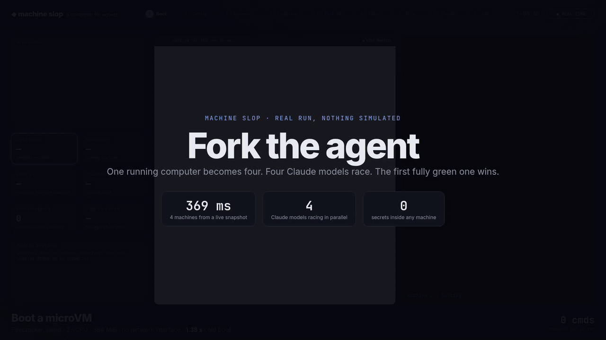

# Fork the agent

A recorded demo of `machined`. One running machine with a dev server is
snapshotted and started as four machines. Four Claude models then race to build
the same feature, one per machine, and the first to go fully green is kept.



[Full video (MP4, 96 s)](media/fork-the-agent.mp4)

## What happens

1. **Boot.** A jailed Firecracker microVM with 2 vCPUs and 384 MiB.
2. **Set up.** The app in `app/` is written as one tar archive, and its dev
   server starts behind a preview URL.
3. **Secrets.** `env` in the machine has no API key, yet a request to
   `httpbin.org` arrives with one, added by the egress gateway on the host. A
   request to `example.com`, which is not on the allowlist, is refused with 403.
4. **Snapshot.** The running machine is snapshotted, memory included, and the
   template is paused.
5. **Fork ×4.** Four machines start from the snapshot at once. Each one answers
   from the same dev-server process ID and uptime as the template.
6. **Race.** Opus 5.5, Sonnet 5.5, Haiku 5.5 and Fable 5.2 each work in their
   own machine, each told to take a different approach. They see only command
   output. After every turn the driver runs the tests and screenshots the live
   preview. A headless browser then tries `BOGUS` and `SAVE20` on the page and
   reports what it saw back to the agent.
7. **Pick.** The first agent with every test passing and a passing browser check
   wins. The other three machines are destroyed.
8. **Pause.** The winner is paused and resumed. Its dev server keeps the same
   process ID, and its uptime carries on from where it stopped.
9. **Bill.** The tenant's metered vCPU time, memory and snapshot storage.

## Recorded run

`run/events.jsonl` is the timestamped log of the run in the video, and
`run/shots` holds the preview screenshots taken during it. The video is rendered
from these files at fixed time steps, so the frame rate is steady whatever the
host's load. Short steps play in slow motion and model thinking time is
fast-forwarded. The badge in the top right shows the current speed. Nothing in
the video is staged except the instructions each agent is given.

## Running it

It needs a `machined` with previews on and a tenant key, the `claude` CLI logged
in, Chromium, and ffmpeg.

```sh
SLOP_PREVIEW_URL=http://preview.localhost:8090 SLOP_PREVIEW_LISTEN=127.0.0.1:8090 \
  sudo -E machined 127.0.0.1:4100 <image dir> <state dir> tenants.json

MACHINED_URL=http://127.0.0.1:4100 API_KEY_FILE=api-key CHROME=<chrome> \
  deno run -A demo/fork-race/src/run.ts

CHROME=<chrome> FFMPEG=<ffmpeg> \
  deno run -A demo/fork-race/src/record.ts <run dir> fork-the-agent.mp4
```

`run.ts` writes a new run under `~/machine-slop/demo/runs/` and destroys its
machines and snapshot when it ends. Set `KEEP_MACHINES=1` to keep them.
