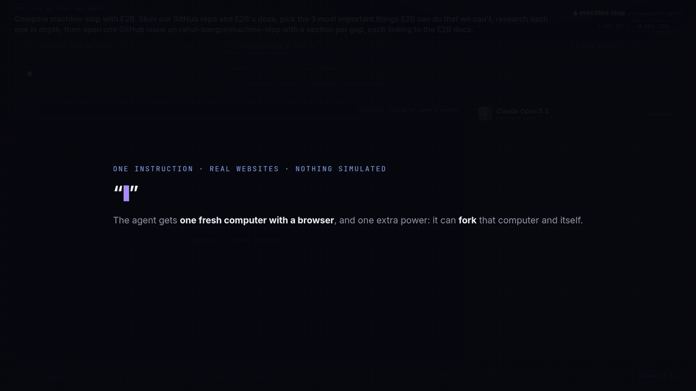

# Fork the agent: research in parallel

One agent, one machine, a real task on real websites. Partway through, the agent
forks: the running machine and the agent's own conversation are copied three
times, and each copy researches one topic in parallel.



[Full video (MP4, 89 s)](media/fork-the-agent-research.mp4)

The task given to Claude Opus 5.5:

> Compare machine-slop with E2B. Skim our GitHub repo and E2B's docs, pick the 3
> most important things E2B can do that we can't, research each one in depth,
> then open one GitHub issue on rahul-bangre/machine-slop with a section per
> gap, each linking to the E2B docs.

## What happens

1. **Skim and plan.** The agent gets a fresh machine with Chromium in it. It
   reads the repo and the E2B docs in that browser, then replies with `fork` and
   three topics.
2. **Fork.** The machine is paused, which saves its memory and disk. It is then
   snapshotted and started as three machines. Each copy still has the original's
   Chromium running with the same page open, and the same files. The agent's
   conversation is forked with `claude --resume --fork-session`, so each copy
   also remembers everything the original read. The copies get no GitHub token.
3. **Research in parallel.** Each copy reads E2B's docs for its topic and writes
   a section to `/workspace/sections/<n>.md`.
4. **Merge.** The sections are read out of the copies, which are then destroyed.
   The original is resumed with its browser page still open, the sections are
   written into it, and it posts one issue with a plain `curl`. `machined` adds
   the GitHub token on the way out.

In the recorded run the fork took 2.1 s: a 1.6 s pause, a 74 ms snapshot, and
three machines started from it. The three copies did 1 min 56 s of research
between them in 44 s of wall time.
[Issue #29](https://github.com/rahul-bangre/machine-slop/issues/29) was posted 2
min 39 s after the first machine was requested.

The machines have 640 MiB each so that three copies fit in the dev host's memory
while the original is paused.

## Recorded run

`run/events.jsonl` and `run/frames` are the log and browser screenshots of the
run in the video. `src/record.ts` renders them. Model time is fast-forwarded,
the fork and merge are held on screen, and the corner badge shows the current
speed.

```sh
MACHINED_URL=http://127.0.0.1:4100 API_KEY_FILE=api-key \
  deno run -A demo/fork-research/src/run.ts

CHROME=<chrome> FFMPEG=<ffmpeg> \
  deno run -A demo/fork-research/src/record.ts <run dir> out.mp4
```

Each run creates a real issue on the repository named by `REPOSITORY`.
