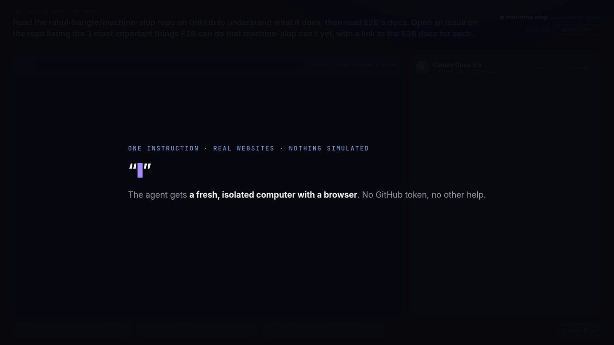

# An agent files a real GitHub issue

One prompt, one agent, one fresh machine, real websites.



[Full video (MP4, 56 s)](media/agent-files-github-issue.mp4)

The task given to Claude Opus 5.5:

> Read the rahul-bangre/machine-slop repo on GitHub to understand what it does,
> then read E2B's docs. Open an issue on the repo listing the 3 most important
> things E2B can do that machine-slop can't yet, with a link to the E2B docs for
> each.

The agent gets a new `machined` machine with Chromium and nothing else. Each
reply it gives is one step: open a page, run a shell command, or finish. When it
opens a page it receives the page's text and links. The screenshots in the video
come from that same Chromium, running inside the machine.

The machine can reach only `github.com`, `e2b.dev` and their subdomains. It has
no GitHub token. To create the issue the agent runs a plain
`curl -X POST https://api.github.com/...`, and `machined` adds the
`Authorization` header on the way out, so the token never enters the machine.

In the recorded run the agent read five pages, posted
[issue #28](https://github.com/rahul-bangre/machine-slop/issues/28) 58 s after
the machine was requested, and used about $0.002 of compute.

## Recorded run

`run/events.jsonl` is the timestamped log and `run/frames` holds the browser
screenshots. `src/record.ts` renders them into the video: the agent's work is
fast-forwarded, the moment it posts is held, and the badge in the corner shows
the current speed.

## Running it

It needs a `machined` with a tenant key, the `gh` and `claude` CLIs logged in,
Chromium on the host for rendering, and ffmpeg. The issue is created with the
`gh` login's token, which is passed to `machined` only as an egress credential.

```sh
MACHINED_URL=http://127.0.0.1:4100 API_KEY_FILE=api-key \
  deno run -A demo/github-issue/src/run.ts

CHROME=<chrome> FFMPEG=<ffmpeg> \
  deno run -A demo/github-issue/src/record.ts <run dir> out.mp4
```

Each run creates a new issue on the repository named by `REPOSITORY`.
